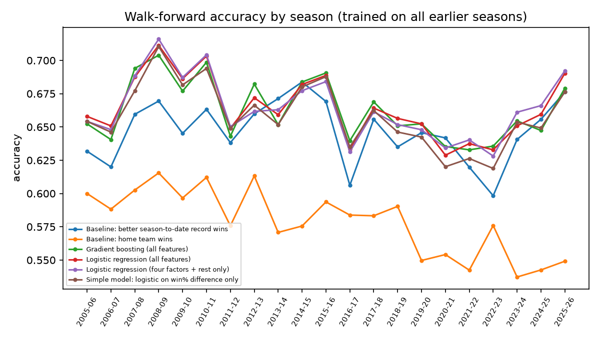
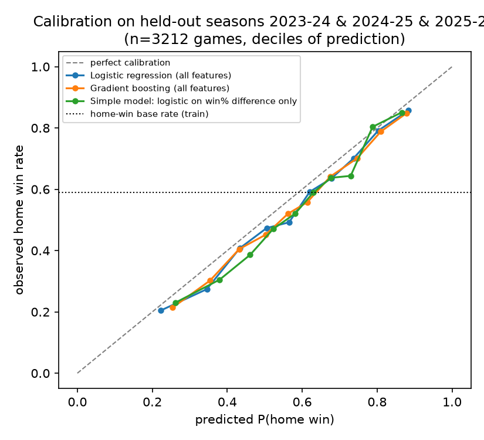
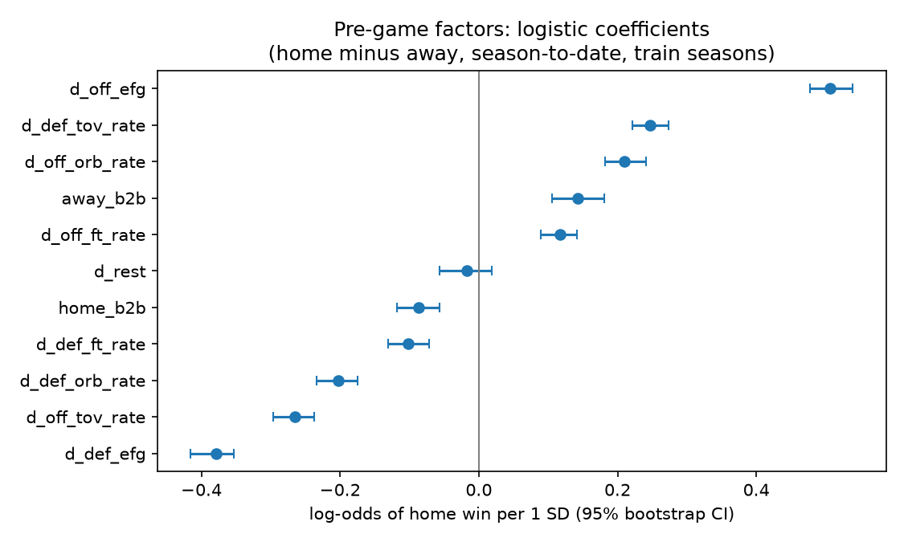

# What drives NBA wins?

Two related questions, kept apart on purpose:

1. **Predictive:** using only what is known before tipoff, how well can we forecast whether the home team wins, and which team characteristics carry that signal?
2. **Descriptive:** within a game that has already been played, which of Dean Oliver's four factors (shooting, turnovers, offensive rebounding, free throws) account for the final margin?

Question 2 uses box-score stats from the game itself. Those are consequences of the result, so they can explain it but cannot forecast it. They never enter the predictive models.

## Data

- Source: stats.nba.com `LeagueGameLog` endpoint (team rows), via [`nba_api`](https://github.com/swar/nba_api). Fetched 2026-11-07 with `scripts/fetch_data.py`.
- Seasons: 2000-01 through 2025-26 regular seasons (26 seasons), one CSV per season in `data/raw/` (8.5 MB, committed). The analysis reads only these files; it makes no network calls.
- Size: 31,245 games after dropping neutral-site games. 2011-12 (990 games), 2019-20 and 2020-21 were shortened by lockout and COVID.
- `load_team_logs` validates the snapshot on every load (no nulls, exactly two rows per game, no duplicates, no negative box-score values) and fails loudly otherwise.
- Neutral-site games (Paris, Mexico City, NBA Cup semifinals) list both teams as away and are dropped.
- One row per game is built from `MATCHUP` (`LAL vs. MIN` = LAL at home). Target: `home_win` (home points > away points).

## Method

**Pre-game features** (`nbawin/features.py`). For every team, season-to-date means over its *earlier* games of that season (the per-game series is shifted one game before the expanding mean):

- win %, net rating (point differential per 100 possessions)
- offensive four factors: eFG%, turnover rate, offensive rebound rate, free-throw rate
- the same four factors allowed on defense
- days of rest (capped at 7) and a back-to-back flag

The model sees home-minus-away differences of these, plus the rest difference and each side's back-to-back flag. Home advantage lives in the intercept. Games where either team has fewer than 10 earlier games that season are dropped (4,063 games, mostly each season's first three weeks), leaving 27,182. Every model and baseline is scored on the same rows.

**Split.** Train on 2000-01 to 2022-23 (23,970 games), test on 2023-24, 2024-25 and 2025-26 (3,212 games). The last training game is earlier than the first test game (asserted in code and in a test). Hyperparameters are fixed, not tuned, so the test seasons were not used for model selection. A second, independent check is a **walk-forward backtest**: every season from 2005-06 on is scored by models trained only on the seasons before it.

**Baselines.**
- *Home team wins*: always predicts home; its probability is the training home-win rate (0.590).
- *Better season-to-date record wins*: picks the team with the higher win % before the game, ties to home. A hard rule, so log loss is not defined for it.
- *Logistic on win % difference only*: a one-feature probabilistic version of the record rule.

**Models.** Logistic regression (standardized inputs, C=1) on all features; the same on the four factors and rest only (no win %, no net rating); `HistGradientBoostingClassifier` (depth 3, 300 iterations, learning rate 0.05, min leaf 50) on all features.

**Uncertainty.** 95% percentile bootstrap over test games (1,000 resamples). Model-vs-baseline differences use paired resamples, so both are scored on the same games. Coefficient CIs come from refitting on 200 bootstrap resamples of the training games.

## Results

From `results/report.md`, generated by the run below. Test set: 3,212 games, 2023-24 to 2025-26.

| Model | Accuracy [95% CI] | Log loss [95% CI] | Brier | ECE |
|---|---|---|---|---|
| Baseline: home team wins | 0.543 [0.526, 0.560] | 0.6939 [0.688, 0.700] | 0.2503 | 0.047 |
| Baseline: better season-to-date record wins | 0.658 [0.640, 0.674] | n/a | n/a | n/a |
| Logistic regression (all features) | 0.664 [0.650, 0.679] | 0.6053 [0.591, 0.619] | 0.2090 | 0.036 |
| Logistic regression (four factors + rest only) | 0.672 [0.657, 0.687] | 0.6054 [0.591, 0.619] | 0.2089 | 0.038 |
| Gradient boosting (all features) | 0.663 [0.648, 0.679] | 0.6098 [0.595, 0.624] | 0.2108 | 0.040 |
| Simple model: logistic on win% difference only | 0.659 [0.643, 0.674] | 0.6154 [0.602, 0.629] | 0.2138 | 0.047 |

Per-season accuracy, paired bootstrap deltas and every coefficient are in `results/report.md`.

What this says, plainly:

- Every model beats "home team wins" by a wide margin (about +12 accuracy points).
- **On the held-out seasons no model clearly beats "the team with the better record wins" on accuracy**: the all-features logistic is 0.7 points better (95% interval [-0.7, +2.1]) and the four-factors-plus-rest logistic, the best single model, is 1.5 points better with an interval of [0.0, +2.9], on the edge of significance.
- The walk-forward backtest is kinder to the models: averaged over 21 seasons they reach about 0.664 accuracy against 0.647 for the record rule, and they beat it in most seasons. Treat the edge as real but small, roughly 1 to 2 points.
- On probabilities, the full logistic regression is reliably better than a logistic on win % alone (log loss about -0.010, interval excludes zero). Four factors, rest and back-to-backs add a small, real signal beyond record.
- Gradient boosting does no better than logistic regression, and is worse on log loss in the walk-forward (0.612 vs 0.609).
- The four-factors-only logistic matches the full model on log loss and leads slightly on accuracy. Win % and net rating are summaries of the four factors and add little once those are in.
- Accuracy tops out near 66 to 67%. Pre-game box-score averages leave most of a single game's outcome unexplained.

### Home-court drift

Home teams won about 60% of games through 2018-19 and 54 to 58% since (2019-20 onward: bubble, empty arenas, then a lasting shift). Training on all history therefore sets the home intercept too high for recent seasons: the home baseline's ECE is 0.047 on the test seasons. Walk-forward scores each season with a model that has not seen the new regime, which is why its numbers are a harsher but more honest picture than a single split.



### Calibration



Predicted probabilities track observed home-win rates across deciles (ECE 0.04 for the models). Remaining miscalibration is mostly the home-court drift above.

### Which pre-game factors matter

Standardized coefficients from the four-factors-only logistic regression, fit on the training seasons (log-odds of a home win per 1 SD of the home-minus-away difference, 95% bootstrap CI):



| Feature (home minus away, season-to-date) | Coefficient [95% CI] |
|---|---|
| Offensive eFG% | +0.51 [0.48, 0.54] |
| Opponent eFG% allowed | -0.38 [-0.42, -0.35] |
| Offensive turnover rate | -0.27 [-0.30, -0.24] |
| Opponent turnover rate forced | +0.25 [0.22, 0.27] |
| Offensive rebound rate | +0.21 [0.18, 0.24] |
| Opponent offensive rebound rate allowed | -0.20 [-0.23, -0.18] |
| Away team on a back-to-back | +0.14 [0.11, 0.18] |
| Free-throw rate | +0.12 [0.09, 0.14] |
| Opponent free-throw rate allowed | -0.10 [-0.13, -0.07] |
| Home team on a back-to-back | -0.09 [-0.12, -0.06] |
| Rest days difference | -0.02 [-0.06, 0.02] |

Shooting efficiency, on both ends, is the strongest pre-game signal, followed by turnovers and rebounding; free-throw rate is weaker. Back-to-backs matter; extra rest beyond that does not show a measurable effect. Permutation importance on the test seasons (in `results/metrics.json`) puts net rating first, then win %, then offensive eFG% for the logistic model. Correlated features share credit, so permutation importance understates each of them.

### Descriptive: what separates winners within a game

Linear regression of home margin on same-game home-minus-away four factors, trained on 2000-01 to 2022-23 and evaluated on the three test seasons. **These are outcomes of the game, not predictors.**

- Test R² for margin: 0.945. A logistic on the same four numbers calls the winner in 95.8% of test games. This is the kind of number the original scaffold reported by training on `PLUS_MINUS`; it measures how a game was won, not whether it can be forecast.
- Points of margin per 1 SD (95% bootstrap CI): eFG% +12.3 [12.3, 12.4], turnover rate -5.9 [-6.0, -5.9], offensive rebound rate +5.3 [5.3, 5.4], free-throw rate +2.9 [2.8, 2.9].

Shooting comes first, then turnovers and rebounding, then free throws. That is the same order as the pre-game coefficients, and close to Oliver's 40/25/20/15 weighting.

## Limitations

- No player-level information: injuries, rest days of stars, trades and lineup changes are invisible. Season-to-date averages lag these.
- No betting lines. The market spread is the real benchmark for game forecasts and would very likely beat these models.
- Early-season games (first 10 per team) are excluded, so these results do not cover the opening weeks.
- Home advantage fell from about 60% to 54-58% around 2019-20 (bubble, empty arenas). The models carry one intercept for all training years, so they overstate home advantage on recent seasons. A year-weighted or rolling-window training set is the obvious next experiment.
- The game itself changed over 26 seasons (three-point volume roughly doubled). Walk-forward shows no collapse, but the coefficients are an average over eras.
- Three test seasons are about 3,200 games, so accuracy differences under about 1.5 points cannot be separated from noise. The CIs say so.
- Bootstrap CIs resample games as independent. Games share teams and dates, so the true uncertainty is somewhat larger.
- Season-to-date stats reset every October; the previous season is not used as a prior.

## Reproduce

Requires [uv](https://docs.astral.sh/uv/) and Python 3.12 (pinned in `.python-version`; versions locked in `uv.lock`).

```bash
uv sync --locked                 # install pinned dependencies
uv run pytest                    # 13 tests, about 90 s
uv run python -m nbawin.run      # full analysis, about 5 min; writes results/
```

`results/metrics.json` has every number above; `results/report.md` has the main table. All randomness is seeded.

To refresh the raw data (needs network; stats.nba.com may rate-limit):

```bash
uv run --group fetch python scripts/fetch_data.py
```

## Layout

```
data/raw/            game logs, one CSV per season (source of truth)
nbawin/data.py       load logs, build one row per game
nbawin/features.py   pre-game features and same-game four factors
nbawin/metrics.py    ECE, scoring, bootstrap CIs
nbawin/run.py        models, baselines, figures, report
scripts/fetch_data.py
tests/               feature arithmetic, leakage, split, metrics
docs/PRD.md          goals, non-goals, success criteria
.github/workflows/   CI: locked install + tests
results/             generated outputs (committed for reading on GitHub)
```

## What was removed and why

The first version of this repo (still in git history, commit `9fd741c`) had a FastAPI service, a Streamlit page, an MLflow server and docker-compose. They were removed instead of fixed:

- `api/app/main.py` constructed `NBADataProcessor(request.seasons)`, but the constructor also requires `job_id`, so the only real endpoint failed on every call. No model was trained or served.
- All services pinned 2021-era packages on Python 3.9 and depended on live stats.nba.com calls.
- The training script (`from sklearn.py`) defined the target as `PLUS_MINUS > 0` and used same-game box-score stats including `PLUS_MINUS` itself as features, with a random split: target leakage.
- `data/trd_stats_2025.csv` had 682 games of 2024-25, 623 of them duplicated, with no dates or home/away flag. Its box-score columns match the league game log used here exactly (except `TO`, which counts turnovers differently), so it was replaced.
