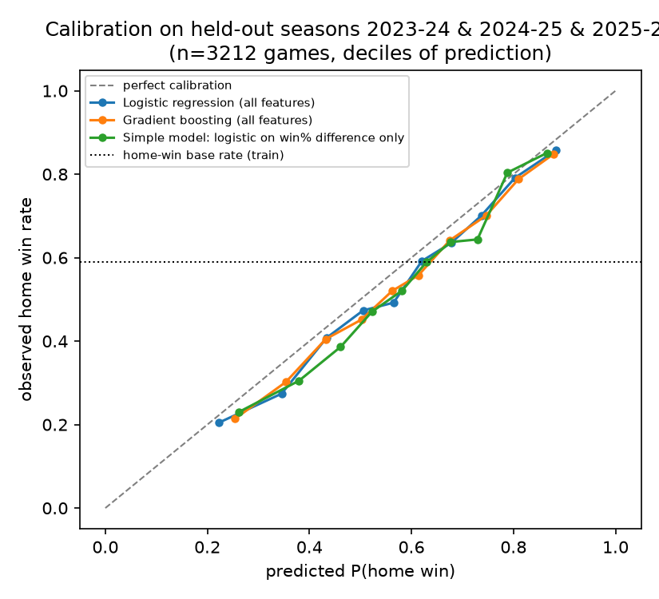
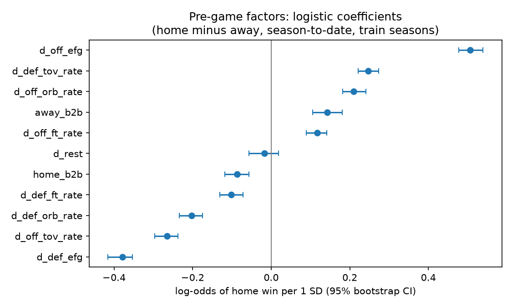
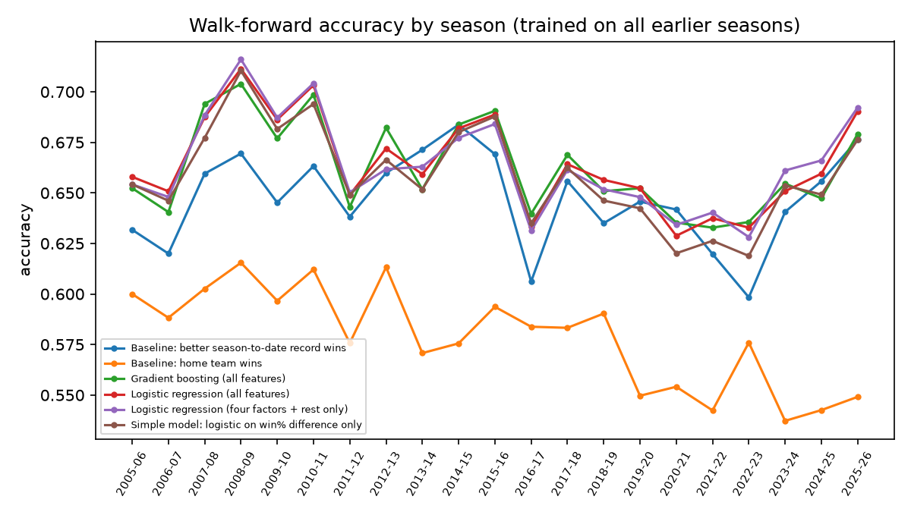

Train: 23970 games (2000-01 to 2022-23). Test: 3212 games (2023-24, 2024-25, 2025-26).

## Forecasting: pre-game features only

| Model | Accuracy [95% CI] | Log loss [95% CI] | Brier | ECE | Acc 2023-24 | Acc 2024-25 | Acc 2025-26 |
|---|---|---|---|---|---|---|---|
| Baseline: home team wins | 0.543 [0.526, 0.560] | 0.6939 [0.688, 0.700] | 0.2503 | 0.047 | 0.537 | 0.543 | 0.549 |
| Baseline: better season-to-date record wins | 0.658 [0.640, 0.674] | n/a | n/a | n/a | 0.641 | 0.656 | 0.676 |
| Logistic regression (all features) | 0.664 [0.650, 0.679] | 0.6053 [0.591, 0.619] | 0.2090 | 0.036 | 0.651 | 0.659 | 0.683 |
| Logistic regression (four factors + rest only) | 0.672 [0.657, 0.687] | 0.6054 [0.591, 0.619] | 0.2089 | 0.038 | 0.661 | 0.665 | 0.690 |
| Gradient boosting (all features) | 0.663 [0.648, 0.679] | 0.6098 [0.595, 0.624] | 0.2108 | 0.040 | 0.655 | 0.655 | 0.680 |
| Simple model: logistic on win% difference only | 0.659 [0.643, 0.674] | 0.6154 [0.602, 0.629] | 0.2138 | 0.047 | 0.654 | 0.650 | 0.674 |

Paired bootstrap over test games, model minus baseline (positive accuracy delta and negative log-loss delta = model better):

- Logistic regression (all features) vs Baseline: home team wins: accuracy +0.121 [0.101, 0.140], log loss -0.0886 [-0.101, -0.075]
- Logistic regression (all features) vs Baseline: better season-to-date record wins: accuracy +0.007 [-0.007, 0.021]
- Logistic regression (all features) vs Simple model: logistic on win% difference only: accuracy +0.005 [-0.003, 0.015], log loss -0.0101 [-0.014, -0.006]
- Logistic regression (four factors + rest only) vs Baseline: home team wins: accuracy +0.129 [0.109, 0.149], log loss -0.0885 [-0.101, -0.076]
- Logistic regression (four factors + rest only) vs Baseline: better season-to-date record wins: accuracy +0.015 [0.000, 0.029]
- Logistic regression (four factors + rest only) vs Simple model: logistic on win% difference only: accuracy +0.013 [0.003, 0.023], log loss -0.0100 [-0.015, -0.005]
- Gradient boosting (all features) vs Baseline: home team wins: accuracy +0.120 [0.100, 0.140], log loss -0.0841 [-0.097, -0.071]
- Gradient boosting (all features) vs Baseline: better season-to-date record wins: accuracy +0.006 [-0.008, 0.019]
- Gradient boosting (all features) vs Simple model: logistic on win% difference only: accuracy +0.004 [-0.005, 0.013], log loss -0.0056 [-0.009, -0.002]

## What predicts a win before tipoff

Standardized logistic coefficients, home minus away, season-to-date. Positive = raises home win odds.

| Feature | Log-odds per 1 SD [95% CI] |
|---|---|
| d_off_efg | +0.506 [+0.478, +0.539] |
| d_def_efg | -0.379 [-0.415, -0.354] |
| d_off_tov_rate | -0.265 [-0.296, -0.237] |
| d_def_tov_rate | +0.247 [+0.221, +0.273] |
| d_off_orb_rate | +0.210 [+0.182, +0.241] |
| d_def_orb_rate | -0.202 [-0.233, -0.175] |
| away_b2b | +0.143 [+0.105, +0.181] |
| d_off_ft_rate | +0.117 [+0.089, +0.141] |
| d_def_ft_rate | -0.102 [-0.130, -0.071] |
| home_b2b | -0.086 [-0.118, -0.057] |
| d_rest | -0.018 [-0.056, +0.018] |

Permutation importance on test games (increase in log loss when the feature is shuffled):

- Logistic regression (all features): d_net_rtg (0.0228), d_win (0.0100), d_off_efg (0.0078), d_def_efg (0.0038), home_b2b (0.0034)
- Gradient boosting (all features): d_net_rtg (0.0629), d_win (0.0182), home_b2b (0.0018), away_b2b (0.0010), d_off_efg (0.0008)

## Walk-forward across all seasons

Each season is scored by models trained only on earlier seasons (first test season after 5 seasons of history).
Mean over seasons: Baseline: better season-to-date record wins acc 0.647; Baseline: home team wins acc 0.579; Gradient boosting (all features) acc 0.663; Logistic regression (all features) acc 0.664; Logistic regression (four factors + rest only) acc 0.664; Simple model: logistic on win% difference only acc 0.659.
Mean log loss: Gradient boosting (all features) 0.6123; Logistic regression (all features) 0.6087; Logistic regression (four factors + rest only) 0.6096; Simple model: logistic on win% difference only 0.6152.

| Season | Baseline: better season-to-date record wins | Baseline: home team wins | Gradient boosting (all features) | Logistic regression (all features) | Logistic regression (four factors + rest only) | Simple model: logistic on win% difference only |
|---|---|---|---|---|---|---|
| 2005-06 | 0.632 | 0.600 | 0.652 | 0.658 | 0.654 | 0.654 |
| 2006-07 | 0.620 | 0.588 | 0.641 | 0.651 | 0.648 | 0.646 |
| 2007-08 | 0.660 | 0.603 | 0.694 | 0.688 | 0.688 | 0.677 |
| 2008-09 | 0.669 | 0.615 | 0.704 | 0.711 | 0.716 | 0.710 |
| 2009-10 | 0.645 | 0.597 | 0.677 | 0.686 | 0.687 | 0.682 |
| 2010-11 | 0.663 | 0.612 | 0.699 | 0.703 | 0.704 | 0.694 |
| 2011-12 | 0.638 | 0.576 | 0.643 | 0.649 | 0.650 | 0.649 |
| 2012-13 | 0.660 | 0.613 | 0.682 | 0.672 | 0.662 | 0.666 |
| 2013-14 | 0.671 | 0.571 | 0.652 | 0.659 | 0.663 | 0.652 |
| 2014-15 | 0.684 | 0.576 | 0.684 | 0.682 | 0.677 | 0.680 |
| 2015-16 | 0.669 | 0.594 | 0.691 | 0.689 | 0.684 | 0.688 |
| 2016-17 | 0.606 | 0.584 | 0.640 | 0.633 | 0.631 | 0.635 |
| 2017-18 | 0.656 | 0.583 | 0.669 | 0.664 | 0.661 | 0.662 |
| 2018-19 | 0.635 | 0.590 | 0.651 | 0.656 | 0.652 | 0.646 |
| 2019-20 | 0.646 | 0.550 | 0.652 | 0.652 | 0.648 | 0.642 |
| 2020-21 | 0.642 | 0.554 | 0.635 | 0.629 | 0.634 | 0.620 |
| 2021-22 | 0.620 | 0.542 | 0.633 | 0.637 | 0.640 | 0.626 |
| 2022-23 | 0.598 | 0.576 | 0.636 | 0.633 | 0.628 | 0.619 |
| 2023-24 | 0.641 | 0.537 | 0.655 | 0.651 | 0.661 | 0.654 |
| 2024-25 | 0.656 | 0.543 | 0.647 | 0.659 | 0.666 | 0.649 |
| 2025-26 | 0.676 | 0.549 | 0.679 | 0.690 | 0.692 | 0.676 |

Home win rate by season (the home-court edge shrank after 2018-19, so older training data miscalibrates recent seasons): 2000-01 0.597, 2001-02 0.588, 2002-03 0.624, 2003-04 0.615, 2004-05 0.606, 2005-06 0.600, 2006-07 0.588, 2007-08 0.603, 2008-09 0.615, 2009-10 0.597, 2010-11 0.612, 2011-12 0.576, 2012-13 0.613, 2013-14 0.571, 2014-15 0.576, 2015-16 0.594, 2016-17 0.584, 2017-18 0.583, 2018-19 0.590, 2019-20 0.550, 2020-21 0.554, 2021-22 0.542, 2022-23 0.576, 2023-24 0.537, 2024-25 0.543, 2025-26 0.549.

## What explains a win after the fact

Same-game four-factor differences against final margin. These are outcomes, not predictors: test R2 on margin is 0.945 and they call 95.8% of winners, which is why the forecasting table above is the honest measure of what is knowable in advance.

| Factor | Points of margin per 1 SD [95% CI] |
|---|---|
| d_efg | +12.31 [+12.26, +12.36] |
| d_tov_rate | -5.93 [-5.98, -5.89] |
| d_orb_rate | +5.34 [+5.30, +5.38] |
| d_ft_rate | +2.85 [+2.81, +2.89] |

## Beyond the four factors: a wide factor screen

50 candidate factors, each added to team strength (Elo, season-to-date net rating) and the current home-court regime. Train 23970 games, test 3212. 'z' is the in-sample Wald statistic (Bonferroni threshold 3.29); 'test log-loss change' is out of sample (negative = better), with a paired bootstrap CI.

| Factor | Family | Effect per 1 SD (log-odds) | z | Test log-loss change [95% CI] |
|---|---|---|---|---|
| away_b2b | Rest and schedule load | +0.119 | +8.3* | -0.0009 [-0.0027, +0.0008] |
| d_rest | Rest and schedule load | +0.088 | +6.2* | -0.0018 [-0.0029, -0.0007] |
| away_g4n3 | Rest and schedule load | +0.062 | +4.4* | -0.0003 [-0.0013, +0.0006] |
| d_def_fg3_pct | Pace and style | +0.063 | +4.1* | -0.0005 [-0.0012, +0.0001] |
| home_b2b | Rest and schedule load | -0.056 | -4.0* | -0.0016 [-0.0026, -0.0006] |
| away_g6n5 | Rest and schedule load | +0.052 | +3.7* | -0.0005 [-0.0014, +0.0003] |
| home_alt_km | Altitude | +0.051 | +3.5* | -0.0000 [-0.0008, +0.0009] |
| d_ewm5 | Recent form | +0.097 | +3.3* | -0.0008 [-0.0016, +0.0001] |
| d_ewm8 | Recent form | +0.124 | +3.2 | -0.0007 [-0.0014, +0.0002] |
| d_form10 | Recent form | +0.041 | +2.8 | -0.0006 [-0.0013, +0.0002] |
| d_ewm20 | Recent form | +0.217 | +2.7 | -0.0003 [-0.0010, +0.0003] |
| d_def_orb_rate | Four factors | -0.037 | -2.5 | -0.0001 [-0.0007, +0.0004] |
| d_ast_rate | Pace and style | +0.035 | +2.4 | +0.0006 [-0.0000, +0.0011] |
| d_blk_rate | Pace and style | +0.029 | +2.0 | -0.0002 [-0.0007, +0.0003] |

Era confound: raw league pace looks predictive (z -3.8) but shrinks to z -2.4 once the home-court regime is controlled, because pace rose while home advantage fell. The model uses era-relative pace instead.

### Factor families

Gain over strength-only (log loss, positive = family helps) and loss when removed from the full model:

| Family | Factors | Gain over strength [95% CI] | Loss if removed [95% CI] |
|---|---|---|---|
| Strength | 3 | baseline | -0.0001 [-0.0014, +0.0012] |
| Recent form | 4 | +0.0008 [-0.0000, +0.0017] | +0.0008 [-0.0001, +0.0018] |
| Four factors | 8 | +0.0004 [-0.0005, +0.0015] | -0.0000 [-0.0010, +0.0011] |
| Pace and style | 11 | +0.0000 [-0.0011, +0.0011] | -0.0003 [-0.0015, +0.0010] |
| Rest and schedule load | 7 | +0.0032 [+0.0010, +0.0055] | +0.0034 [+0.0012, +0.0056] |
| Home stands and road trips | 2 | -0.0002 [-0.0008, +0.0004] | -0.0003 [-0.0009, +0.0003] |
| Travel and time zones | 6 | +0.0004 [-0.0003, +0.0012] | +0.0003 [-0.0003, +0.0010] |
| Altitude | 2 | +0.0001 [-0.0009, +0.0009] | +0.0001 [-0.0009, +0.0009] |
| Luck and regression | 2 | +0.0001 [-0.0002, +0.0004] | +0.0000 [-0.0006, +0.0006] |
| Volatility and matchup shape | 4 | -0.0001 [-0.0004, +0.0003] | -0.0001 [-0.0004, +0.0002] |
| Era regime | 1 | baseline | +0.0019 [+0.0008, +0.0030] |
| Calendar and rematches | 3 | +0.0000 [-0.0003, +0.0003] | +0.0000 [-0.0002, +0.0003] |

All 53 factors in a logistic model: log loss 0.5986, accuracy 0.678 (strength only 0.6029, 0.672; gradient boosting 0.6030).

### How long is a team's memory?

Leave-one-season-out log loss of one rating signal (lower is better):

| Signal | Log loss | SE |
|---|---|---|
| EWMA half-life 2 games | 0.6393 | 0.0029 |
| EWMA half-life 3 games | 0.6305 | 0.0032 |
| EWMA half-life 5 games | 0.6207 | 0.0035 |
| EWMA half-life 8 games | 0.6144 | 0.0037 |
| EWMA half-life 12 games | 0.6113 | 0.0038 |
| EWMA half-life 20 games | 0.6097 | 0.0039 |
| EWMA half-life 30 games | 0.6096 | 0.0040 |
| EWMA half-life 50 games | 0.6098 | 0.0040 |
| EWMA half-life 80 games | 0.6101 | 0.0040 |
| Season-to-date net rating | 0.6108 | 0.0041 |
| Elo (carries over across seasons) | 0.6074 | 0.0038 |

### Skill or luck? Persistence of team stats

Split-half reliability (odd vs even games, Spearman-Brown) and year-over-year correlation:

| Stat | Split-half | Year over year |
|---|---|---|
| Three-point attempt rate | 1.00 | 0.92 |
| Opponent three-point attempt rate | 0.99 | 0.96 |
| Pace | 0.98 | 0.86 |
| Foul rate | 0.96 | 0.79 |
| Offensive eFG% | 0.95 | 0.83 |
| Opponent eFG% allowed | 0.95 | 0.84 |
| Offensive rebound rate | 0.94 | 0.71 |
| Assist rate | 0.94 | 0.67 |
| Opponent turnovers forced | 0.92 | 0.61 |
| Net rating | 0.91 | 0.59 |
| Free-throw rate | 0.91 | 0.66 |
| Opponent offensive rebounds allowed | 0.91 | 0.76 |
| Opponent free-throw rate allowed | 0.90 | 0.69 |
| Block rate | 0.90 | 0.63 |
| Turnover rate | 0.90 | 0.65 |
| Win % | 0.88 | 0.60 |
| Steal rate | 0.87 | 0.49 |
| Free-throw % | 0.87 | 0.55 |
| Three-point % | 0.60 | 0.40 |
| Opponent three-point % allowed | 0.35 | 0.22 |

### Opening weeks: Elo vs this season's record

| Games played | Test games | Home | Elo | Record |
|---|---|---|---|---|
| games 1-5 | 239 | 0.540 | 0.636 | 0.577 |
| 6-10 | 229 | 0.616 | 0.664 | 0.686 |
| 11-20 | 460 | 0.576 | 0.670 | 0.676 |
| 21-40 | 909 | 0.550 | 0.644 | 0.640 |
| 41-60 | 892 | 0.511 | 0.647 | 0.640 |
| 61+ | 951 | 0.550 | 0.710 | 0.715 |

### Home-court value by franchise (league average 2.7 points, controlling for Elo)

| Franchise | Points | SE |
|---|---|---|
| DEN | 3.96 | 0.40 |
| UTA | 3.71 | 0.40 |
| GSW | 3.67 | 0.40 |
| OKC | 3.38 | 0.40 |
| IND | 3.32 | 0.40 |
| SAS | 3.13 | 0.40 |
| LAC | 2.96 | 0.40 |
| HOU | 2.88 | 0.40 |
| LAL | 2.88 | 0.40 |
| POR | 2.84 | 0.40 |
| CLE | 2.79 | 0.40 |
| BOS | 2.78 | 0.40 |
| PHX | 2.67 | 0.40 |
| ATL | 2.66 | 0.40 |
| MIL | 2.65 | 0.40 |
| DAL | 2.63 | 0.40 |
| MEM | 2.55 | 0.40 |
| TOR | 2.52 | 0.40 |
| ORL | 2.47 | 0.40 |
| DET | 2.46 | 0.40 |
| SAC | 2.45 | 0.40 |
| MIN | 2.42 | 0.40 |
| MIA | 2.38 | 0.40 |
| NOP | 2.36 | 0.40 |
| WAS | 2.19 | 0.40 |
| NYK | 2.10 | 0.40 |
| CHA | 2.03 | 0.43 |
| PHI | 1.99 | 0.40 |
| CHI | 1.90 | 0.40 |
| BKN | 1.67 | 0.40 |
